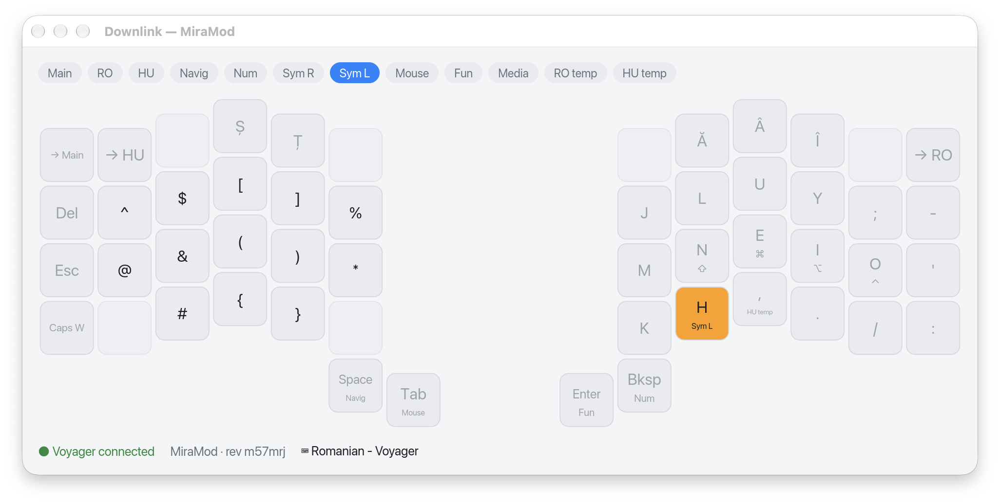
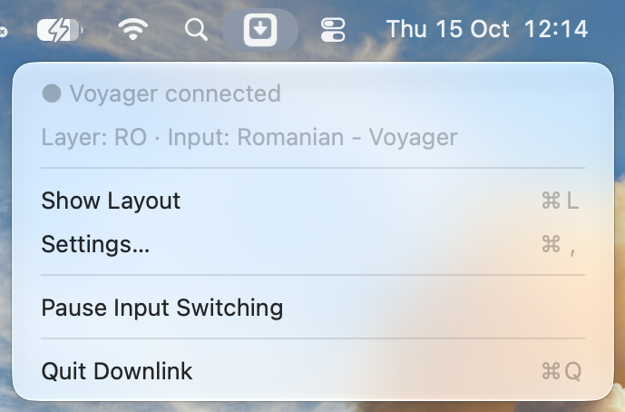
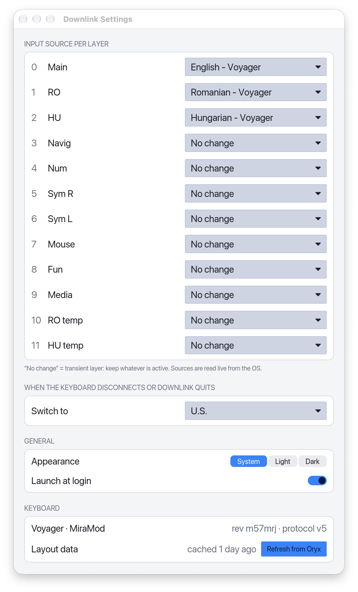

# Downlink

A small menu-bar app for the **ZSA Voyager** keyboard:

<picture>
  <source media="(prefers-color-scheme: dark)" srcset="docs/images/layout-dark.png">
  
</picture>

- **Live layout view.** Shows the layout flashed on your keyboard, follows the active layer and highlights the keys you press. Keys a layer leaves transparent show, greyed out, what they fall through to.
- **Per-layer input-source switching.** For example: Main → English, RO layer → Romanian, HU layer → Hungarian. Transient layers (Navigation, Symbols, …) leave the input source alone.
- **Reconnects by itself** after sleep, wake and replugging.
- **Follows the system Light/Dark** automatically.

Downlink talks to the keyboard directly over USB. You don't need Keymapp running.

> Downlink is an independent project. It is **not affiliated with or endorsed by ZSA Technology Labs**.
> "ZSA", "Voyager", "Oryx" and "Keymapp" are used only to describe compatibility.

## Requirements

- A ZSA Voyager running Oryx firmware (any layout built in Oryx)
- macOS 13 or newer, or Linux with Hyprland (tested on Omarchy)
- To build: Rust stable ≥ 1.90 (`rustup`). On macOS, also Xcode Command Line Tools.

## Build and install on macOS

```bash
packaging/macos/bundle.sh
cp -R target/bundle/Downlink.app /Applications/
open /Applications/Downlink.app
```

The Downlink key icon appears in the menu bar. Its menu shows the connection, the active layer and
the input source:



Open **Settings…** to choose an input source for each layer and the fallback used when the keyboard
disconnects or Downlink quits. Turn on **Launch at login** there, too.



⌘W and ⌘Q close Downlink's windows but keep it running in the menu bar. To quit, use **Quit
Downlink** in the menu-bar menu.

## Build and install on Linux (Hyprland)

1. Let your user open the keyboard (once, needs sudo). On Arch, install ZSA's rules package:

   ```bash
   sudo pacman -S zsa-udev
   ```

   Elsewhere, install Downlink's rule:

   ```bash
   sudo install -m644 packaging/linux/50-zsa.rules /etc/udev/rules.d/
   sudo udevadm control --reload && sudo udevadm trigger
   ```

   Replug the Voyager afterwards. Without a rule, the menu says "No permission to open the
   keyboard".
2. Install the binary, launcher entry and icons into `~/.local`:

   ```bash
   packaging/linux/install.sh
   ```

3. Start **Downlink** from your app launcher. Its icon appears in the bar's tray (Omarchy shows
   it with the `omarchy.tray` widget), and the Layout window opens. Starting it again while it
   runs brings its window forward.

Downlink switches Hyprland's keyboard layouts: list every layout you want to switch to in
`kb_layout` (at most four), for example `kb_layout = "us,de"`. To see their IDs:
`cargo run -p input-source --example list`. Closing a window (for example with Meta+W) keeps
Downlink running; to quit, use **Quit Downlink** in the tray menu.

## Moving over from Keymapp and a layout-switcher script

1. Quit Keymapp and turn off its "start at login" option, or uninstall it. Keymapp opens the
   keyboard's raw-HID interface exclusively, so Downlink cannot connect while Keymapp is running:
   Keymapp must be quit. Downlink needs no Input Monitoring permission.
2. If you used a script or service that switched input sources from Keymapp's API, unload it,
   for example `launchctl unload ~/Library/LaunchAgents/<its label>.plist`.
3. Open Downlink's Settings and map your layers.

## Configuration

On macOS, settings are saved in `~/Library/Application Support/Downlink/config.toml`:

```toml
appearance = "system"          # "system" | "light" | "dark"
launch_at_login = true

[switching]
fallback = "com.apple.keylayout.US"

[switching.layers]               # keyed by Oryx layer index; unlisted layers don't switch
"0" = "com.apple.keylayout.US"
"1" = "com.apple.keylayout.Romanian-Standard"
```

To list the input-source IDs: `cargo run -p input-source --example list`.

- Layout data is fetched once per revision from Oryx and cached in `~/Library/Caches/Downlink/`.
- Logs are in `~/Library/Logs/Downlink/`. Set `DOWNLINK_LOG=debug` for more detail.

On Linux, settings are in `~/.config/downlink/config.toml`, the layout cache in
`~/.cache/downlink/`, and logs in `~/.local/state/downlink/`. Layout IDs are Hyprland's
`kb_layout` entries, with the variant in brackets when there is one:

```toml
[switching]
fallback = "us"

[switching.layers]
"0" = "us"
"1" = "de(nodeadkeys)"
```

Launch at login writes `~/.config/autostart/downlink.desktop`.

## Development

```bash
cargo test --workspace
cargo clippy --workspace --all-targets -- -D warnings
cargo run -p downlink                      # run without bundling
cargo run -p oryx-device --example watch   # print raw keyboard events
```

The design is in `docs/superpowers/specs/2026-10-13-downlink-design.md`.

## License

MIT. See [LICENSE](LICENSE).
